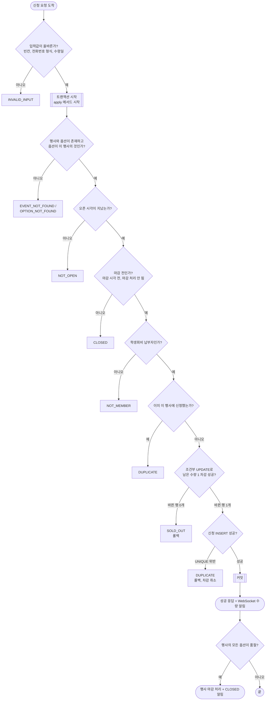

# 설계: 4. 서버 및 통신

담당: 오지우

## 0. 먼저 정한 것

| 항목 | 결정 | 이유 |
| --- | --- | --- |
| 화면 구현 방식 | HTML + JavaScript, 서버와는 JSON으로 데이터만 주고받음 | 화면 담당과 서버 담당이 API 명세만 맞추면 따로 개발할 수 있음. WebSocket으로 받은 수량을 JavaScript로 바로 화면에 반영해야 해서 어차피 JavaScript가 필요함 |
| DB 접근 방식 | JdbcTemplate | 수업에서 배운 JDBC + DAO 방식과 가장 비슷함 |
| 실시간 통신 | Spring WebSocket (TextWebSocketHandler) | 수업에서 배운 소켓 브로드캐스트(접속자 목록에 차례로 보내기)와 구조가 같음 |
| 동시 신청 처리 | DB 조건부 UPDATE + @Transactional + UNIQUE 제약 | 정원 검사와 차감을 DB가 한 번에 처리해서 정원 초과가 생기지 않음 |
| 관리자 접근 제한 | 비밀번호 확인 후 세션에 관리자 표시, 인터셉터로 관리자 API 검사 | 학생 로그인 없이 관리자만 보호하면 됨 |

---


## 4-1. Spring Boot 요청 처리 구조

- Spring Boot에 들어 있는 Tomcat이 요청 하나마다 스레드 하나를 배정한다. 스레드는 직접 만들지 않는다.
- Controller, Service, DAO 객체는 서버 전체에서 하나씩만 만들어지고(싱글톤), 모든 요청 스레드가 같은 객체를 함께 쓴다.

**공유 데이터 보호 규칙**

| 규칙 | 이유 |
| --- | --- |
| Service, DAO에는 요청마다 바뀌는 값을 필드로 두지 않는다. 필요한 값은 메서드 매개변수와 지역변수로만 다룬다. | 필드는 모든 스레드가 함께 쓰므로, 두 요청이 동시에 바꾸면 값이 섞임 |
| 남은 수량처럼 여러 요청이 함께 바꾸는 값은 DB에만 저장하고, DB에서 한 번에 검사하고 바꾼다. (4-4) | 자바 변수로 들고 있으면 동시성 문제를 직접 막아야 함 |
| WebSocket 접속자 목록은 `ConcurrentHashMap.newKeySet()`처럼 동시 접근에 안전한 Set을 쓴다. | 접속·해제와 브로드캐스트가 서로 다른 스레드에서 동시에 일어남 |
| 같은 WebSocket 세션에 여러 스레드가 동시에 메시지를 보내지 않도록, 세션을 `ConcurrentWebSocketSessionDecorator`로 감싸서 저장한다. | 하나의 세션에 동시에 `sendMessage`를 호출하면 오류가 남 |

## 4-2. API 명세

공통 규칙
- 주소는 `/api`로 시작한다. 관리자 API는 `/api/admin`으로 시작한다.
- 요청과 응답은 JSON이다. 날짜는 `"2026-11-20"`, 날짜와 시각은 `"2026-11-20T12:00:00"` 형식이다.
- 실패 응답은 HTTP 상태 코드와 함께 `{ "success": false, "code": "...", "message": "..." }` 형식으로 보낸다.

### 학생 API

| 순위 | 기능 | 방식 | URL | 요구사항 |
| --- | --- | --- | --- | --- |
| 1 | 행사 목록 조회 | GET | `/api/events` | R1 |
| 1 | 행사 상세, 옵션별 남은 수량 조회 | GET | `/api/events/{eventId}` | R2, R4 |
| 1 | 신청 | POST | `/api/events/{eventId}/applications` | R3~R5, R18~R23, R27~R32 |
| 2 | 내 신청 내역 조회 | GET | `/api/applications?studentId=...&name=...` | R6 |

**GET /api/events** 응답 200
```json
[
  {
    "eventId": 1,
    "name": "기말고사 간식 행사",
    "openAt": "2026-12-09T12:00:00",
    "closeAt": "2026-12-10T18:00:00",
    "status": "OPEN"
  }
]
```

**GET /api/events/{eventId}** 응답 200
```json
{
  "eventId": 1,
  "name": "기말고사 간식 행사",
  "openAt": "2026-12-09T12:00:00",
  "closeAt": "2026-12-10T18:00:00",
  "status": "OPEN",
  "pickupDates": ["2026-12-11", "2026-12-12"],
  "options": [
    { "optionId": 1, "name": "논비건 버거", "capacity": 30, "remaining": 12 },
    { "optionId": 2, "name": "비건 버거", "capacity": 10, "remaining": 0 }
  ]
}
```
- `remaining`이 0이면 화면에서 품절로 표시한다.
- `status`가 `UPCOMING`이면 신청 버튼을 막고 오픈 시각을 보여준다.

**POST /api/events/{eventId}/applications** 요청
```json
{
  "studentId": "2566035",
  "name": "오지우",
  "phone": "010-1234-5678",
  "optionId": 1,
  "pickupDate": "2026-12-11"
}
```
응답 200 (성공)
```json
{
  "success": true,
  "code": "SUCCESS",
  "message": "신청이 완료되었습니다.",
  "applicationId": 15,
  "optionId": 1,
  "remaining": 11,
  "eventClosed": false
}
```
응답 409 (실패 예시)
```json
{
  "success": false,
  "code": "SOLD_OUT",
  "message": "품절된 메뉴입니다."
}
```

**GET /api/applications?studentId=2566035&name=오지우** 응답 200
```json
[
  {
    "applicationId": 15,
    "eventId": 1,
    "optionName": "논비건 버거",
    "pickupDate": "2026-12-11",
    "appliedAt": "2026-12-09T12:00:03"
  }
]
```
신청 내역이 없으면 빈 배열 `[]`을 보낸다.

### 관리자 API

`/api/admin/login`을 제외한 모든 관리자 API는 로그인한 관리자만 호출할 수 있다. (4-7)

| 순위 | 기능 | 방식 | URL | 요청 | 요구사항 |
| --- | --- | --- | --- | --- | --- |
| 3 | 로그인 | POST | `/api/admin/login` | `{ "password": "..." }` | R16, R35 |
| 3 | 로그아웃 | POST | `/api/admin/logout` | | |
| - | 행사 생성 | POST | `/api/admin/events` | 아래 예시 | R7~R9, R34 |
| 3 | 행사 삭제 | DELETE | `/api/admin/events/{eventId}` | | R15 |
| 2 | 납부자 등록 | POST | `/api/admin/members` | `[{ "studentId": "...", "name": "..." }]` | R10 |
| - | 신청자 명단 | GET | `/api/admin/events/{eventId}/applications` | | R11, R24 |
| - | 옵션별 집계 | GET | `/api/admin/events/{eventId}/summary` | | R12, R25 |
| 3 | 입금 여부 변경 | PATCH | `/api/admin/applications/{applicationId}/paid` | `{ "paid": true }` | R14 |
| 3 | CSV 다운로드 | GET | `/api/admin/events/{eventId}/applications.csv` | | R13 |

순위가 `-`인 기능은 우선순위 목록에 없는 기능이다. (아래 "확인이 필요한 부분" 참고)

**POST /api/admin/events** 요청
```json
{
  "name": "기말고사 간식 행사",
  "openAt": "2026-12-09T12:00:00",
  "closeAt": "2026-12-10T18:00:00",
  "pickupDates": ["2026-12-11", "2026-12-12"],
  "options": [
    { "name": "논비건 버거", "capacity": 30 },
    { "name": "비건 버거", "capacity": 10 }
  ]
}
```
응답 201: `{ "eventId": 1 }`

**GET /api/admin/events/{eventId}/summary** 응답 200
```json
[
  { "optionId": 1, "optionName": "논비건 버거", "count": 30 },
  { "optionId": 2, "optionName": "비건 버거", "count": 10 }
]
```

## 4-3. 신청 처리 순서와 실패 응답 코드

### 신청 처리 순서도



- R18의 순서(신청 기간 → 납부 여부 → 중복 → 남은 수량)를 그대로 따른다.
- 입력값 검사는 Controller에서 하고, 그 뒤 `ApplyService.apply()`가 시작되면서 트랜잭션이 시작된다. 중간에 실패하면 `ApplyException`을 던지고, 트랜잭션은 롤백된다.
- 납부 여부 확인(G)은 2순위 기능이다. 1순위에서는 이 단계를 건너뛴다.
- H(중복 확인)는 친절한 안내를 빨리 보내기 위한 1차 검사이다. 같은 학생이 두 탭에서 동시에 신청하면 H를 둘 다 통과할 수 있으므로, 최종적으로는 DB의 UNIQUE 제약(J)이 막는다.

### 실패 응답 코드 (ErrorCode)

| 코드 | HTTP 상태 | 안내 메시지 | 요구사항 |
| --- | --- | --- | --- |
| `SUCCESS` | 200 | 신청이 완료되었습니다. | R5 |
| `INVALID_INPUT` | 400 | 입력값을 다시 확인해주세요. | |
| `EVENT_NOT_FOUND` | 404 | 존재하지 않는 행사입니다. | |
| `OPTION_NOT_FOUND` | 404 | 존재하지 않는 메뉴입니다. | |
| `NOT_OPEN` | 409 | 아직 신청 기간이 아닙니다. | R27 |
| `CLOSED` | 409 | 마감된 행사입니다. | R32 |
| `NOT_MEMBER` | 403 | 학생회비 미납부자입니다. | R28 |
| `DUPLICATE` | 409 | 이미 신청한 행사입니다. | R29 |
| `SOLD_OUT` | 409 | 품절된 메뉴입니다. | R30, R31 |
| `INVALID_CAPACITY` | 400 | 정원은 1 이상이어야 합니다. | R34 |
| `ADMIN_AUTH_FAILED` | 401 | 비밀번호가 올바르지 않습니다. | R35 |
| `ADMIN_REQUIRED` | 401 | 관리자 로그인이 필요합니다. | |
| `SERVER_ERROR` | 500 | 잠시 후 다시 시도해주세요. | |

- 화면은 `code`로 상황을 구분하고, `message`를 그대로 사용자에게 보여준다.
- 예상하지 못한 오류는 모두 `SERVER_ERROR`로 응답하고, 자세한 내용은 서버 로그에만 남긴다.

## 4-4. 동시 신청 처리 및 DB 트랜잭션

### 처리 방식

**1) 남은 수량 차감: 조건부 UPDATE**
```sql
UPDATE event_option
SET remaining = remaining - 1
WHERE option_id = ? AND remaining > 0;
```
- `remaining > 0` 검사와 차감을 SQL 한 문장으로 처리한다. MariaDB은 같은 행을 바꾸는 UPDATE를 한 번에 하나씩 처리하므로, 마지막 1개에 10명이 동시에 요청해도 1명만 바뀐 행 1개를 받고 나머지 9명은 0개를 받는다.
- 바뀐 행이 0개면 `SOLD_OUT`으로 처리한다.

**2) 신청 저장: UNIQUE 제약**
```sql
UNIQUE (event_id, student_id)
```
- 같은 학생이 같은 행사에 두 번 저장되는 것을 DB가 막는다. 위반되면 `DuplicateKeyException`이 발생하고, 이를 `DUPLICATE`로 바꿔 응답한다.

**3) 둘을 하나로 묶기: @Transactional**
- `ApplyService.apply()`에 `@Transactional`을 붙인다.
- 수량 차감은 성공했는데 신청 저장이 실패하면(중복 등) 트랜잭션 전체가 롤백되어 차감도 취소된다. 그래서 남은 수량과 실제 신청 수가 항상 맞는다.

### 다른 방법과 비교

| 방법 | 장점 | 단점 | 선택 |
| --- | --- | --- | --- |
| `synchronized` (Java) | 수업에서 배운 방법, 이해하기 쉬움 | 서버 프로그램 하나에서만 효과가 있고, 모든 행사의 신청이 한 줄로 서서 느려짐. 트랜잭션 커밋 전에 잠금이 풀리면 여전히 문제가 생길 수 있음 | 사용 안 함 (비교 테스트용으로만) |
| 조회 후 UPDATE (`SELECT` → 자바에서 비교 → `UPDATE`) | 코드가 직관적 | 조회와 수정 사이에 다른 요청이 끼어들어 정원 초과 발생 | 사용 안 함 |
| `SELECT ... FOR UPDATE` (행 잠금) | 확실함 | SQL과 트랜잭션 개념이 더 필요함 | 사용 안 함 |
| 조건부 UPDATE + UNIQUE + @Transactional | 짧고 확실함, DB가 동시성을 보장 | SQL에 조건을 넣어야 함 | **선택** |

중간보고서 트러블슈팅용으로, `synchronized` 없이 "조회 후 UPDATE" 방식으로 먼저 만들어 정원 초과가 생기는 것을 테스트로 확인하고, 조건부 UPDATE로 고친 과정을 기록하면 좋다.

### 동시 신청 테스트 (ApplyServiceTest)

| 테스트 | 준비 | 예상 결과 |
| --- | --- | --- |
| 정원 초과 방지 | 정원 1인 옵션, 서로 다른 학번 10명이 스레드 10개로 동시에 신청 | 성공 1명, `SOLD_OUT` 9명, 남은 수량 0 |
| 정원만큼 성공 | 정원 5인 옵션, 10명 동시 신청 | 성공 5명, 남은 수량 0, 신청 행 5개 |
| 동시 중복 신청 | 같은 학번으로 스레드 5개가 동시에 신청 | 성공 1번, `DUPLICATE` 4번, 남은 수량 1만 줄어듦 |

여러 스레드를 동시에 출발시키는 데는 `CountDownLatch`를 사용한다.

## 4-5. 옵션 품절 / 행사 마감 처리

**행사 상태 계산**

| 상태 | 조건 |
| --- | --- |
| `UPCOMING` (오픈 전) | 현재 시각 < 오픈 시각 |
| `OPEN` (진행 중) | 오픈 시각 ≤ 현재 시각 < 마감 시각, 그리고 `closed = false` |
| `CLOSED` (마감) | 현재 시각 ≥ 마감 시각, 또는 `closed = true` |

- 상태는 DB에 따로 저장하지 않고, 조회할 때마다 현재 시각으로 계산한다. 단, 모두 품절되어 일찍 마감된 경우는 `event.closed` 값으로 표시한다.

**옵션 품절** (1순위)
- 남은 수량이 0이 되면 별도 처리 없이 `remaining: 0`을 알린다. 화면은 0이면 품절로 표시하고 버튼을 막는다.
- 신청할 때 조건부 UPDATE가 0행을 바꾸면 `SOLD_OUT`으로 응답한다.

**모든 옵션 품절 시 마감** (2순위, R23)
- `ApplyService.apply()` 안에서 신청 저장 후 `optionDao.countAvailable(eventId)`가 0이면 `eventDao.markClosed(eventId)`로 `closed = true`를 저장하고, 응답의 `eventClosed`를 `true`로 한다.
- `ApplyController`는 커밋이 끝난 뒤 `eventClosed`가 `true`이면 `notifyClosed(eventId)`로 `CLOSED` 메시지를 보낸다. (수량 알림과 같은 이유로 커밋 뒤에 보냄)

**마감 시각 도달 시 마감** (2순위, R23, R32)
- 신청할 때 항상 현재 시각과 마감 시각을 비교하므로, 마감 시각이 지나면 별도 처리 없이도 신청이 거절된다. (1순위부터 적용)
- 이미 열려 있는 화면에도 마감을 알리기 위해 `EventCloseScheduler`를 둔다.
  - `@Scheduled(fixedRate = 10000)`으로 10초마다 실행한다.
  - 마감 시각이 지났는데 `closed = false`인 행사를 찾아 `closed = true`로 바꾸고 `CLOSED` 메시지를 보낸다.
  - 실행 파일에 `@EnableScheduling`을 붙여야 동작한다.

## 4-6. WebSocket 실시간 알림 및 연결 끊김 처리

**연결 정보**
- 주소: `ws://서버주소/ws/stock`
- 학생 행사 페이지와 관리자 명단 페이지가 열릴 때 연결한다.
- 서버는 모든 접속자에게 같은 메시지를 보내고, 화면은 자기가 보고 있는 `eventId`의 메시지만 반영한다. (1순위에서는 행사가 하나뿐이라 단순하게 처리)

**메시지 형식** (서버 → 브라우저, JSON)

| type | 언제 | 예시 |
| --- | --- | --- |
| `STOCK` | 신청 성공으로 남은 수량이 바뀌었을 때 | `{ "type": "STOCK", "eventId": 1, "optionId": 1, "remaining": 11 }` |
| `CLOSED` | 행사가 마감되었을 때 | `{ "type": "CLOSED", "eventId": 1 }` |

브라우저 → 서버로 보내는 메시지는 없다. 신청은 항상 HTTP API로 한다.

**화면 처리**
- `STOCK`: 해당 옵션의 남은 수량을 바꾸고, 0이면 품절 표시와 버튼 비활성화
- `CLOSED`: 신청 버튼 전체 비활성화, "마감된 행사입니다." 표시

**연결 끊김 처리** (R26, R33)

| 쪽 | 처리 |
| --- | --- |
| 서버 | 연결이 끊긴 세션은 `afterConnectionClosed`, `handleTransportError`에서 접속자 목록에서 지운다. 한 세션에 보내다 오류가 나도 다른 세션에는 계속 보낸다. |
| 화면 | `onclose`가 발생하면 "서버와 연결이 끊어졌습니다." 안내를 보여주고, 3초마다 다시 연결을 시도한다. |
| 화면 | 다시 연결되면 `GET /api/events/{eventId}`로 최신 수량을 다시 불러온다. 끊겨 있는 동안 놓친 알림이 있을 수 있기 때문이다. |
| 화면 | 신청 요청 자체가 실패하면(네트워크 오류) "신청 결과를 확인하지 못했습니다. 신청 내역에서 확인해주세요." 안내를 보여준다. |

## 4-7. 관리자 페이지 접근 제한

**처리 방식: 세션**
1. 관리자가 `admin/login.html`에서 비밀번호를 입력하면 `POST /api/admin/login`을 호출한다.
2. 서버는 `application-local.properties`의 `app.admin.password` 값과 비교한다. (비밀번호는 코드와 GitHub에 올리지 않는다)
3. 맞으면 세션에 `ADMIN = true`를 저장하고 200을 보낸다. 틀리면 401 `ADMIN_AUTH_FAILED`를 보낸다.
4. `AdminInterceptor`가 `/api/admin/**` 요청마다 세션의 `ADMIN` 값을 확인하고, 없으면 401 `ADMIN_REQUIRED`를 보낸다. (`/api/admin/login`은 검사에서 제외)
5. 관리자 HTML 페이지는 열 때 관리자 API를 호출하고, 401을 받으면 `admin/login.html`로 이동한다.

- 화면 파일(HTML) 자체가 아니라 데이터를 주는 API를 막는 방식이다. 학생이 관리자 페이지 주소를 직접 입력해도, 화면 틀만 보이고 데이터는 받을 수 없으며 곧바로 로그인 페이지로 이동한다.
- 로그아웃하면 세션을 지운다. (`session.invalidate()`)

---

## 확인이 필요한 부분

| 항목 | 내용 | 관련 |
| --- | --- | --- |
| 행사 생성 | 1~3순위 목록에 행사 생성(R7~R9)이 없음. 1순위는 `data.sql`로 테스트 행사를 넣고, 관리자 행사 생성을 몇 순위로 할지 정해야 함 | 변연경, 서유정 |
| 신청자 명단, 집계 | R11, R12, R24, R25도 순위 목록에 없음. 시연에 필요하므로 2순위에 넣는 것을 제안 | 전체 |
| 수령 일자 | 학생이 고를 수령일을 어디에 저장할지 (예: `event_pickup_date` 테이블) DB 설계에서 정해야 함. API는 `pickupDates` 배열로 주고받음 | 변연경 |
| 관리자 비밀번호 | `application-local.properties`에 `app.admin.password`를 각자 추가해야 함 | 전체 |
