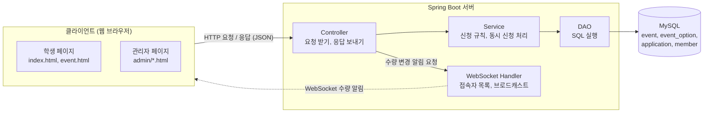
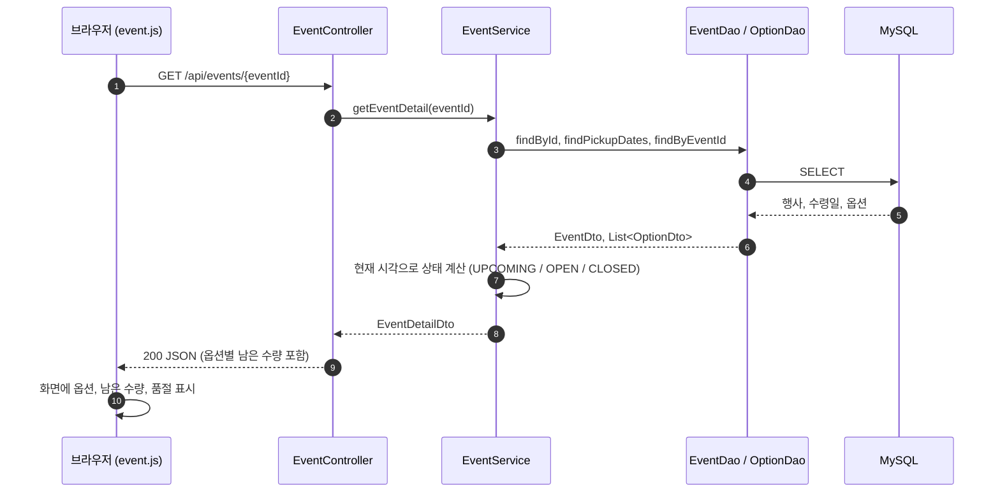
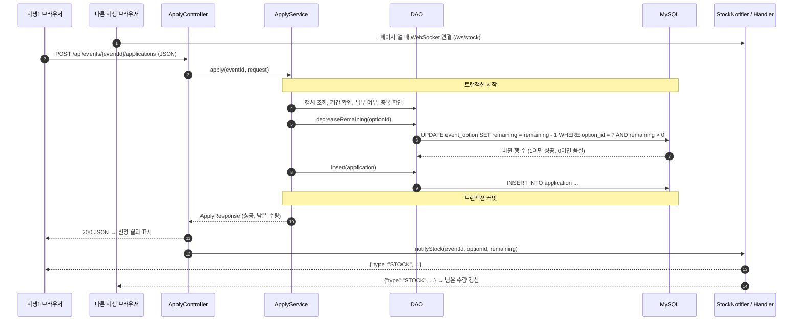

# 설계: 2. 시스템 구조

담당: 오지우

## 0. 먼저 정한 것

| 항목 | 결정 | 이유 |
| --- | --- | --- |
| 화면 구현 방식 | HTML + JavaScript, 서버와는 JSON으로 데이터만 주고받음 | 화면 담당과 서버 담당이 API 명세만 맞추면 따로 개발할 수 있음. WebSocket으로 받은 수량을 JavaScript로 바로 화면에 반영해야 해서 어차피 JavaScript가 필요함 |
| DB 접근 방식 | JdbcTemplate | 수업에서 배운 JDBC + DAO 방식과 가장 비슷함 |
| 실시간 통신 | Spring WebSocket (TextWebSocketHandler) | 수업에서 배운 소켓 브로드캐스트(접속자 목록에 차례로 보내기)와 구조가 같음 |
| 동시 신청 처리 | DB 조건부 UPDATE + @Transactional + UNIQUE 제약 | 정원 검사와 차감을 DB가 한 번에 처리해서 정원 초과가 생기지 않음 |
| 관리자 접근 제한 | 비밀번호 확인 후 세션에 관리자 표시, 인터셉터로 관리자 API 검사 | 학생 로그인 없이 관리자만 보호하면 됨 |

---


## 2-1. 전체 시스템 아키텍처



- 브라우저는 DB에 직접 접근하지 않는다. 모든 데이터는 서버의 API를 통해서만 주고받는다.
- 일반 조회와 신청은 HTTP, 수량 변경 알림은 WebSocket으로 보낸다.
- 서버는 Controller → Service → DAO 3계층으로 나누고, 각 계층은 바로 아래 계층만 호출한다.

## 2-2. View / 서버 / DB 역할 구분

| 영역 | 담당 | 하는 일 | 하지 않는 일 |
| --- | --- | --- | --- |
| View (HTML, CSS, JS) | 서유정 | 화면 표시, 입력값 1차 검사(빈칸, 전화번호 형식), API 호출, 결과 메시지 표시, WebSocket 메시지 받아 수량 갱신 | 정원·중복·납부 여부 판단 (서버가 최종 판단) |
| Controller | 오지우 | URL 연결, 요청 JSON을 DTO로 변환, Service 호출, 응답 JSON 반환, 신청 성공 후 수량 알림 요청 | 신청 규칙 판단, SQL 실행 |
| Service | 오지우 | 신청 조건 검사, 트랜잭션 관리, 행사 상태(오픈 전/진행 중/마감) 계산 | SQL 직접 작성, 화면 처리 |
| WebSocket Handler | 오지우 | 접속자 목록 관리, 수량·마감 메시지 브로드캐스트 | DB 접근 |
| DAO | 변연경 | SQL 실행, 결과를 DTO로 변환 | 신청 규칙 판단 |
| DB (MySQL) | 변연경 | 데이터 저장, UNIQUE·FK 제약으로 잘못된 데이터 차단 | |

## 2-3. 클래스 다이어그램

### 계층별 클래스와 관계

```mermaid
classDiagram
    direction TB

    class EventController {
        -EventService eventService
        +getEvents() List~EventSummaryDto~
        +getEvent(Long eventId) EventDetailDto
    }
    class ApplyController {
        -ApplyService applyService
        -StockNotifier stockNotifier
        +apply(Long eventId, ApplyRequest req) ResponseEntity~ApplyResponse~
        +getMyApplications(String studentId, String name) List~ApplicationDto~
    }
    class AdminController {
        -AdminService adminService
        -EventService eventService
        +login(AdminLoginRequest req, HttpSession session)
        +logout(HttpSession session)
        +createEvent(EventCreateRequest req) Long
        +deleteEvent(Long eventId)
        +registerMembers(List~MemberDto~ members)
        +getApplications(Long eventId) List~ApplicationDto~
        +getSummary(Long eventId) List~SummaryDto~
        +updatePaid(Long applicationId, boolean paid)
        +downloadCsv(Long eventId)
    }

    class EventService {
        -EventDao eventDao
        -OptionDao optionDao
        +getEvents() List~EventSummaryDto~
        +getEventDetail(Long eventId) EventDetailDto
        +getStatus(EventDto event, LocalDateTime now) EventStatus
        +createEvent(EventCreateRequest req) Long
        +deleteEvent(Long eventId)
    }
    class ApplyService {
        -EventDao eventDao
        -OptionDao optionDao
        -ApplicationDao applicationDao
        -MemberDao memberDao
        +apply(Long eventId, ApplyRequest req) ApplyResponse
        +getMyApplications(String studentId, String name) List~ApplicationDto~
    }
    class AdminService {
        -String adminPassword
        -ApplicationDao applicationDao
        -MemberDao memberDao
        +checkPassword(String password) boolean
        +registerMembers(List~MemberDto~ members)
        +getApplications(Long eventId) List~ApplicationDto~
        +getSummary(Long eventId) List~SummaryDto~
        +updatePaid(Long applicationId, boolean paid)
        +toCsv(Long eventId) String
    }
    class EventCloseScheduler {
        -EventDao eventDao
        -StockNotifier stockNotifier
        +closeExpiredEvents()
    }

    class StockNotifier {
        -StockWebSocketHandler handler
        +notifyStock(Long eventId, Long optionId, int remaining)
        +notifyClosed(Long eventId)
    }
    class StockWebSocketHandler {
        -Set~WebSocketSession~ sessions
        +afterConnectionEstablished(session)
        +afterConnectionClosed(session, status)
        +broadcast(String json)
    }

    class EventDao {
        +findAll() List~EventDto~
        +findById(Long eventId) EventDto
        +findPickupDates(Long eventId) List~LocalDate~
        +insert(EventCreateRequest req) Long
        +delete(Long eventId)
        +markClosed(Long eventId) int
        +findExpiredOpenEvents(LocalDateTime now) List~EventDto~
    }
    class OptionDao {
        +findByEventId(Long eventId) List~OptionDto~
        +findById(Long optionId) OptionDto
        +decreaseRemaining(Long optionId) int
        +countAvailable(Long eventId) int
        +insertAll(Long eventId, List options)
    }
    class ApplicationDao {
        +insert(Long eventId, ApplyRequest req) Long
        +exists(Long eventId, String studentId) boolean
        +findByStudent(String studentId, String name) List~ApplicationDto~
        +findByEvent(Long eventId) List~ApplicationDto~
        +countByOption(Long eventId) List~SummaryDto~
        +updatePaid(Long applicationId, boolean paid) int
    }
    class MemberDao {
        +exists(String studentId) boolean
        +insertAll(List~MemberDto~ members)
    }

    EventController --> EventService
    ApplyController --> ApplyService
    ApplyController --> StockNotifier
    AdminController --> AdminService
    AdminController --> EventService

    EventService --> EventDao
    EventService --> OptionDao
    ApplyService --> EventDao
    ApplyService --> OptionDao
    ApplyService --> ApplicationDao
    ApplyService --> MemberDao
    AdminService --> ApplicationDao
    AdminService --> MemberDao

    EventCloseScheduler --> EventDao
    EventCloseScheduler --> StockNotifier
    StockNotifier --> StockWebSocketHandler
```



- Controller는 Service만, Service는 DAO만 사용한다. (연관 관계, 필드로 가짐)
- Service와 DAO는 Spring이 객체를 하나만 만들어 생성자로 넣어 준다. (의존성 주입)
- `ApplyController`가 `StockNotifier`를 호출하는 이유는 2-5와 「4. 서버 및 통신」 문서의 4-4에 정리했다. (트랜잭션이 끝난 뒤 알림을 보내기 위해)

### 그 밖의 클래스

| 클래스 | 패키지 | 역할 |
| --- | --- | --- |
| `WebSocketConfig` | config | `/ws/stock` 주소에 `StockWebSocketHandler` 연결 |
| `WebConfig` | config | `/api/admin/**`에 `AdminInterceptor` 적용 (로그인 API 제외) |
| `AdminInterceptor` | config | 세션에 관리자 표시가 없으면 401 응답 |
| `ErrorCode` | exception | 실패 코드, HTTP 상태, 안내 메시지 (enum) |
| `ApplyException` | exception | 신청 실패 시 `ErrorCode`를 담아 던지는 예외 |
| `GlobalExceptionHandler` | exception | `ApplyException`을 받아 실패 응답 JSON으로 변환 |
| `EventStatus` | dto | `UPCOMING`(오픈 전), `OPEN`(진행 중), `CLOSED`(마감) (enum) |

### DTO 필드

| DTO | 필드 | 사용처 |
| --- | --- | --- |
| `EventDto` | eventId, name, openAt, closeAt, closed | DAO ↔ Service |
| `EventSummaryDto` | eventId, name, openAt, closeAt, status | 행사 목록 응답 |
| `EventDetailDto` | eventId, name, openAt, closeAt, status, pickupDates, options | 행사 상세 응답 |
| `OptionDto` | optionId, eventId, name, capacity, remaining | 옵션 정보 |
| `ApplyRequest` | studentId, name, phone, optionId, pickupDate | 신청 요청 |
| `ApplyResponse` | success, code, message, applicationId, optionId, remaining, eventClosed | 신청 결과 |
| `ApplicationDto` | applicationId, eventId, optionId, optionName, studentId, name, phone, pickupDate, appliedAt, paid | 신청 내역, 명단 |
| `MemberDto` | studentId, name | 납부자 등록 |
| `SummaryDto` | optionId, optionName, count | 옵션별 집계 |
| `StockMessage` | type, eventId, optionId, remaining | WebSocket 메시지 |
| `AdminLoginRequest` | password | 관리자 로그인 |
| `EventCreateRequest` | name, openAt, closeAt, pickupDates, options(name, capacity) | 행사 생성 |

DTO 필드 이름은 「4. 서버 및 통신」 문서의 API 명세(4-2)에 나오는 JSON 이름과 같게 한다. 화면, 서버, DB 담당이 같은 이름을 쓰기 위해서다.

## 2-4. 패키지 및 프로젝트 폴더 구조

```
snack/
├── src/main/java/com/coma/snack/
│   ├── SnackApplication.java
│   ├── config/        WebSocketConfig, WebConfig, AdminInterceptor
│   ├── controller/    EventController, ApplyController, AdminController
│   ├── service/       EventService, ApplyService, AdminService, EventCloseScheduler
│   ├── websocket/     StockWebSocketHandler, StockNotifier
│   ├── dao/           EventDao, OptionDao, ApplicationDao, MemberDao
│   ├── dto/           (2-3의 DTO 표 참고), EventStatus
│   └── exception/     ErrorCode, ApplyException, GlobalExceptionHandler
├── src/main/resources/
│   ├── application.properties
│   ├── application-local.properties   (Git 제외: DB 비밀번호, 관리자 비밀번호)
│   ├── schema.sql, data.sql
│   └── static/
│       ├── index.html, event.html, my.html
│       ├── admin/  login.html, events.html, members.html, applicants.html
│       ├── css/style.css
│       └── js/  api.js, socket.js, event.js, my.js, admin.js
└── src/test/java/com/coma/snack/
    └── service/ApplyServiceTest.java
```

- HTML + JavaScript 방식이므로 `templates/`는 쓰지 않고 모든 화면 파일을 `static/`에 둔다.
- `static/`의 파일은 서버 실행 후 `http://localhost:8080/파일이름`으로 바로 열린다.

**우선순위별 파일**

| 순위 | 기능 | 필요한 파일 |
| --- | --- | --- |
| 1순위 | 행사 조회, 신청, 정원 차감, 결과 확인, 동시 신청, 실시간 수량 | EventController, ApplyController, EventService, ApplyService, StockNotifier, StockWebSocketHandler, WebSocketConfig, EventDao, OptionDao, ApplicationDao, 관련 DTO, ErrorCode, ApplyException, GlobalExceptionHandler, index.html, event.html, api.js, socket.js, event.js |
| 2순위 | 납부자 검증, 자동 마감, 신청 내역 조회 | MemberDao, MemberDto, EventCloseScheduler, my.html, my.js |
| 3순위 | CSV, 입금 관리, 행사 삭제, 관리자 | AdminController, AdminService, AdminInterceptor, WebConfig, admin/*.html, admin.js |

1순위에는 행사 생성 기능이 없으므로, 테스트용 행사와 옵션은 `data.sql`로 넣는다.

## 2-5. 데이터 흐름

### 행사 조회



### 신청과 실시간 수량 전달



- 신청한 학생에게는 HTTP 응답으로 결과를 보내고, 모든 접속자에게는 WebSocket으로 바뀐 수량을 보낸다.
- 수량 알림은 트랜잭션이 커밋된 뒤에 보낸다. 신청이 실패해서 되돌려졌는데 수량 알림이 먼저 나가는 일을 막기 위해서다. 그래서 알림은 `ApplyService` 안이 아니라, `apply()`가 끝난 뒤 `ApplyController`에서 호출한다.
